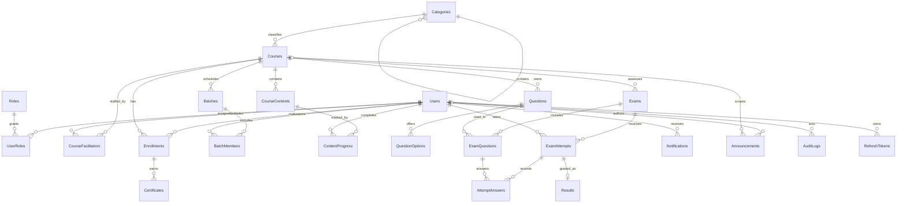

# Learning Management System

Phase 1 establishes the monorepo, a React/Vite frontend, a .NET 8 Clean Architecture API, and a SQL Server EF Core code-first model. It intentionally does not implement authentication, course workflows, or learner-facing features.

## Repository structure

```text
frontend/                 React 18 + TypeScript + Vite
src/
  Lms.Api/                ASP.NET Core API composition root
  Lms.Application/        Application layer
  Lms.Domain/             Domain entities
  Lms.Infrastructure/     EF Core SQL Server persistence and migrations
LMS.sln
```

## Database model

All entities use GUID primary keys and a UTC creation timestamp. Foreign keys, unique constraints, indexes, restrictive deletes for historical/owned data, and range checks are configured in `LmsDbContext`.



The schema includes Users, Roles, Categories, Courses, CourseFacilitators, Enrollments, Batches, BatchMembers, CourseContents, ContentProgress, Questions, QuestionOptions, Exams, ExamQuestions, ExamAttempts, AttemptAnswers, Results, Certificates, Notifications, Announcements, AuditLogs, and RefreshTokens. `UserRoles` is the many-to-many user/role join table.

## Prerequisites

- .NET 8 SDK (the .NET 9 SDK can target `net8.0` if the .NET 8 targeting packs are installed)
- Node.js 20+ and npm
- SQL Server LocalDB on Windows, or another SQL Server instance

## Run and verify

From the repository root, create/update the schema and run the API:

```powershell
dotnet tool install --tool-path .tools dotnet-ef --version 8.0.18
dotnet restore LMS.sln
.\.tools\dotnet-ef.exe database update --project src\Lms.Infrastructure --startup-project src\Lms.Api
dotnet run --project src/Lms.Api --urls http://localhost:5000
```

In another terminal, run the web app:

```powershell
cd frontend
npm install
npm run dev
```

Open `http://localhost:5173`; the overview page reports whether the API health check is reachable. Verify the API directly at `http://localhost:5000/api/health`. For a non-LocalDB SQL Server, set the `ConnectionStrings__Lms` environment variable before running the API and use the same connection in the EF command's environment.

Build checks:

```powershell
dotnet build LMS.sln
cd frontend
npm run build
```

To add a later schema change, edit the domain entities/context and create a migration:

```powershell
.\.tools\dotnet-ef.exe migrations add DescriptiveChange --project src\Lms.Infrastructure --startup-project src\Lms.Api --output-dir Persistence\Migrations
```

## Phase 1 surface

- **API:** `GET /api/health` — returns the API service status; no domain workflows are exposed yet.
- **React:** `App` overview page, API connection status, and Phase 1 foundation checklist. Components and styling are under `frontend/src`.
- **Database:** EF Core entities and SQL Server mappings under `src/Lms.Domain` and `src/Lms.Infrastructure/Persistence`; the initial migration is generated from this model with the command above.
